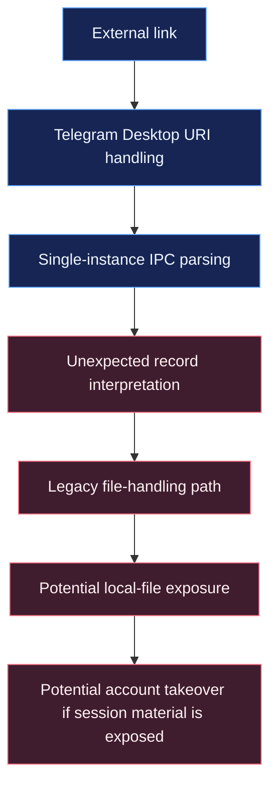

<div align="center">

# `telegram-cve-2026-107181-poc`

### Telegram Desktop · IPC Injection Research

**A research PoC examining unsafe deep-link handling and local-file exposure risks.**

<br>


<br>

> **Research scope:** controlled, authorized testing only. The current instruction-file defaults refer to sensitive Telegram session artifacts. Do not test against a real account or another person's device.

</div>

---

## Contents

- [At a glance](#-at-a-glance)
- [Why this is not conventional RCE](#-why-this-is-not-conventional-rce)
- [How the vulnerability works](#-how-the-vulnerability-works)
- [Repository structure](#-repository-structure)
- [Requirements](#-requirements)
- [Install and inspect](#-install-and-inspect)
- [Instruction files](#-instruction-files)
- [Project scripts](#-project-scripts)
- [Testing and research notes](#-testing-and-research-notes)
- [Safety checklist](#-safety-checklist)
- [References](#-references)
- [License](#-license)

---

## 🔎 At a glance

| Field | Details |
|---|---|
| Identifier | [CVE-2026-107181](https://www.cve.org/CVERecord?id=CVE-2026-107181) |
| Product | Telegram Desktop |
| Technical class | IPC record-separator injection |
| Reported impact | Arbitrary local-file read/exfiltration; potential account takeover |
| User interaction | A user must open a crafted link |
| Affected versions reported by the research | Through 7.2.8 |
| Fixed version reported by the research | 7.2.9 |
| Language | JavaScript / Node.js |
| Runtime | Node.js 18+ |

> Verify affected-version ranges and CVE status against the authoritative record and vendor release history before citing them in a report.

## 🧠 Why this is not conventional RCE

The exploit chain is sometimes loosely described as “RCE,” but the demonstrated impact is more precisely **IPC command injection leading to arbitrary file read and data exfiltration, with potential account takeover**.

- **Injection:** an unescaped record separator can make a crafted URI produce additional IPC records.
- **Unsafe handler:** an injected record can reach a legacy internal file-handling path without appropriate authorization checks.
- **Impact:** local files can be sent to a remote chat. Exposed session material may allow an account to be compromised.

That is a serious vulnerability, but it is not the same as demonstrating arbitrary native code execution or an operating-system shell on the victim's machine. In research notes, describe the demonstrated class and impact rather than relying on the repository name.

## 🧭 How the vulnerability works

The following is a **high-level analysis flow**, not an exploit recipe:



The key lesson is the **combination** of an input-parsing flaw and a sensitive internal operation reachable from that input path. Analyze the parts separately and validate only with harmless fixtures in an isolated lab.

## 🗂️ Repository structure

```text
.
├── bin/
│   └── craft.js
├── scripts/
│   └── generate-instructions.js
├── samples/
├── src/
│   ├── bot.js
│   ├── config.js
│   ├── instructions.js
│   ├── payload.js
│   └── server.js
├── test/
│   └── payload.test.js
├── output/       # generated local files; keep out of Git
├── loot/         # received files; may contain sensitive data
├── server.js     # application entry point
├── package.json
└── README.md
```

Review server routes, bot integration, filesystem writes, and generated instruction contents before running any component. The tree describes the code layout; it is not a recommendation to enable every component.

## ⚙️ Requirements

- **Node.js 18 or newer**
- npm (included with Node.js)
- Git
- A disposable test environment for any dynamic analysis

Verify your local tools:

```bash
node --version
npm --version
git --version
```

## 📥 Install and inspect

Clone your own repository. Replace the URL and directory placeholders with the actual values for your GitHub repository:

```bash
git clone https://github.com/<YOUR-USERNAME>/<YOUR-REPOSITORY>.git
cd <YOUR-REPOSITORY>
npm install
```

For an initial, non-invasive review, inspect the available scripts and run the test suite:

```bash
npm run
npm test
```

### Before starting the server

The current server includes a crafted-link route, file-receiving routes, and an optional Telegram Bot API bridge. The current instruction generator also defines sensitive session-file targets. **Do not run the server or generate/deploy those instructions against a real Telegram profile.**

For safe experimentation, first replace the default targets with harmless synthetic marker files, use a test-only destination, and review or disable network/file-transfer handlers that are not needed. Keep the test isolated and do not expose it to the public internet.

The uploaded files reviewed for this README did not include a guaranteed `.env.example`; check the repository contents before copying one rather than assuming it exists.

## 🧾 Instruction files: how many are configured?

The source currently defines **3 default instruction entries**. The default configured filenames are:

- `instructions1.txt`
- `instructions2.txt`
- `instructions3.txt`

The generator writes one file for each configured entry. The current default entries point to Telegram session-related files, so these are **not harmless sample targets**. The generated content also depends on local configuration, including `CHANNEL_ID` and `TDATA_PREFIX`.

For safety, this README does not provide a turnkey command sequence for generating and deploying the current session-targeting instruction files. For a benign lab demo, change the entries to synthetic files first, then inspect the generated output before use. Never commit generated files, tokens, destination IDs, or captured artifacts.

## 🧩 Project scripts

The `package.json` defines these npm scripts:

| Command | Purpose | Caution |
|---|---|---|
| `npm test` | Runs the Node.js test suite | Recommended first step for code review |
| `npm run` | Lists available npm scripts | Useful for script discovery |
| `npm run start` | Starts the Express application | Starts active routes; review and isolate first |
| `npm run instructions` | Generates instruction files | Current defaults target sensitive session artifacts |
| `npm run craft` | Prints a crafted protocol payload | Review implementation; do not use against others |

These commands are documented for auditability, not as a recommendation to run potentially sensitive functionality.

## 🧪 Testing and research notes

A useful research report should capture:

- Telegram Desktop version, distribution source, and operating system
- Node.js version and repository revision
- Preconditions and user-interaction requirements
- Expected behavior versus observed behavior
- Relevant logs and timestamps, with tokens and personal data removed
- Whether the behavior reproduces with harmless fixtures
- Whether the result changes on a fixed version

Passing repository tests validates only the code paths covered by those tests. It does **not** establish that a live Telegram Desktop build is vulnerable.

## 🔐 Safety checklist

- [ ] Use a disposable VM or lab machine.
- [ ] Use synthetic marker files, never real session data or personal files.
- [ ] Do not test another person's device or account without explicit authorization.
- [ ] Keep `.env`, generated output, logs, and received files out of version control.
- [ ] Never publish bot tokens, session files, channel IDs, or private endpoints.
- [ ] Avoid exposing the server to the public internet.
- [ ] Delete lab artifacts when testing is complete.
- [ ] Stop if real user data is exposed; retain only the minimum evidence needed for responsible reporting.

## 📚 References

- **Original technical research:** [BeakSec — Telegram Desktop: one-click account takeover via IPC injection](https://beaksec.github.io/posts/telegram-desktop-one-click-account-takeover/)
- **CVE record:** [CVE-2026-107181](https://www.cve.org/CVERecord?id=CVE-2026-107181)
- **Vendor fix:** [Telegram Desktop commit `db3405699f`](https://github.com/telegramdesktop/tdesktop/commit/db3405699f8fc3ae28a58d2348b7d13a43c0590a)
- **Release history:** [Telegram Desktop releases](https://github.com/telegramdesktop/tdesktop/releases)

Credit the original researcher when discussing the vulnerability mechanism. Clearly distinguish the original research from behavior independently confirmed in your own lab.

## 📄 License

The package metadata declares the MIT license. Verify that a matching `LICENSE` file is present and applicable to all material in the repository.

---

<div align="center">

**Understand the boundary. Verify the impact. Disclose responsibly.**

<sub>For security research, defensive validation, and responsible disclosure.</sub>

</div>
